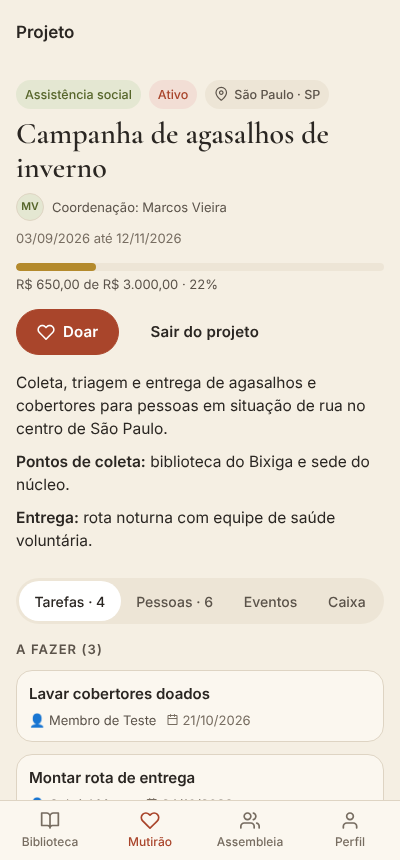
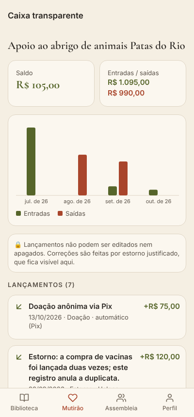
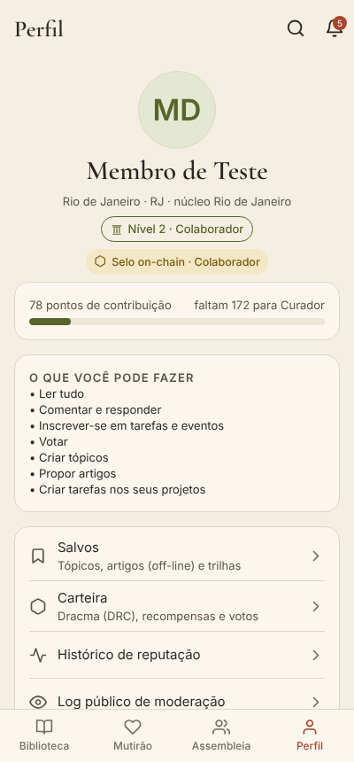
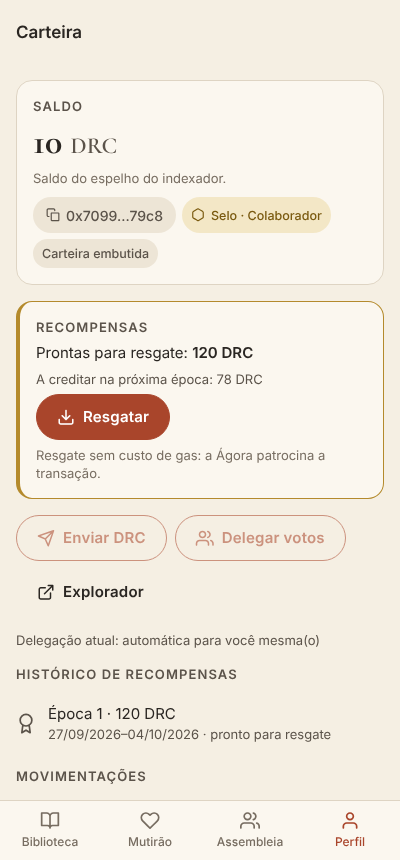

# Ágora — app da comunidade

App móvel (Android e iOS) da **Ágora**, comunidade brasileira paga que sai do Discord para ter casa própria:
troca de conhecimento horizontal (Biblioteca), ações comunitárias com caixa transparente (Mutirão),
decisões coletivas (Assembleia) e um token de governança e reconhecimento on-chain, o **Dracma (DRC)**.

Princípios que viraram regra no código (e no banco, via RLS): **não é rede social** (sem feed algorítmico,
curtidas, seguidores ou rolagem viciante), **conhecimento que fica**, **horizontalidade mecânica** (permissões vêm
de contribuição verificável), **transparência total do dinheiro** e **privacidade por padrão**.

| Biblioteca | Artigo | Projeto | Caixa | Proposta | Perfil | Carteira |
|---|---|---|---|---|---|---|
|  |  |  |  |  |  |  |

---

## Sumário

1. [Stack e estrutura](#stack-e-estrutura)
2. [Requisitos](#requisitos)
3. [Rodar localmente](#rodar-localmente)
4. [Criar o projeto no Supabase (produção/homologação)](#criar-o-projeto-no-supabase)
5. [Variáveis de ambiente](#variáveis-de-ambiente)
6. [Builds com EAS (Android e iOS)](#builds-com-eas)
7. [Blockchain: deploy em testnet, paymaster e carteira embutida](#blockchain)
8. [Credenciais de teste](#credenciais-de-teste)
9. [Testes e verificações](#testes-e-verificações)
10. [Papéis, níveis e permissões](#papéis-níveis-e-permissões)
11. [Modelo de dados (Mermaid)](#modelo-de-dados)
12. [Suposições e pendências](#suposições-e-pendências)

---

## Stack e estrutura

- **App**: React Native 0.86 + **Expo SDK 57**, TypeScript estrito, **Expo Router** (rotas por arquivo),
  **TanStack Query** (cache, paginação por cursor e persistência offline), **Zustand** (estado local),
  **React Hook Form + Zod**, editor/leitor Markdown, `expo-notifications`, `expo-camera` (QR), `expo-image-picker`,
  `expo-calendar`. Fontes: **Cormorant Garamond** (títulos), **Lora** (leitura) e **Inter** (interface).
- **Backend**: **Supabase** — Postgres com RLS em todas as tabelas, triggers de regra de negócio, `pg_cron`, Storage,
  Realtime, Auth (link mágico, Google) e **Edge Functions** (Deno).
- **On-chain**: Solidity 0.8.28 + **Foundry** + **OpenZeppelin Contracts v5.6.1**, rede **Base** (padrão; Base Sepolia em testes)
  ou Polygon PoS. Carteira embutida **thirdweb In-App Wallet** com smart account ERC-4337 e gas patrocinado.

```
agora-app/
├── app/                 rotas (Expo Router)
│   ├── (publico)/       boas-vindas, entrar, sobre (página pública)
│   ├── (onboarding)/    perfil/pseudônimo/cidade/interesses e Código de Conduta
│   ├── (abas)/          biblioteca · mutirao · assembleia · perfil (cada aba com sua pilha)
│   ├── busca.tsx, notificacoes.tsx, denunciar.tsx, inativo.tsx, auth/callback.tsx
├── components/          Card, Botao, ChipTema, Avatar, BadgeNivel, BarraProgresso, LinhaDoTempo,
│                        EstadoVazio (ilustrado), Skeleton, Toast, EditorMarkdown, GraficoBarras…
├── features/            biblioteca · mutirao · assembleia · reputacao · perfil · admin · carteira · busca ·
│                        notificacoes · moderacao  (cada uma com types, services, hooks)
├── lib/                 cliente Supabase, auth, formatos pt-BR, offline, push, upload, datas
├── stores/              Zustand (preferências, sessão, toasts)
├── theme/               design tokens claro/escuro, ThemeProvider, fontes
├── supabase/
│   ├── migrations/      10 migrations: tabelas, permissões, regras, assembleia, moderação, busca, LGPD, on-chain, RLS, storage/cron
│   ├── functions/       Edge Functions (Deno) + _shared (pagamentos, blockchain)
│   ├── seed.sql         dados de exemplo
│   └── tests/           stub local do Supabase + testes de RLS/regras (70+ asserções)
├── contracts/           projeto Foundry (src, test, script, TOKENOMICS.md, SECURITY.md)
└── docs/telas/          capturas de tela
```

## Requisitos

- Node.js 20+ (testado com 22) e npm 10+
- [Supabase CLI](https://supabase.com/docs/guides/cli) 2.x e Docker (para o Supabase local)
- Conta Expo (para EAS) — `npx eas-cli@latest login`
- Para contratos: [Foundry](https://book.getfoundry.sh) (`curl -L https://foundry.paradigm.xyz | bash && foundryup`)
- Opcional: [Deno](https://deno.com) 2.x para checar as Edge Functions; Slither para análise estática

## Rodar localmente

```bash
cd agora-app
npm install                       # .npmrc já usa legacy-peer-deps (peers opcionais da thirdweb)
git submodule update --init --recursive   # libs dos contratos (forge-std, OpenZeppelin)

# 1) Supabase local: sobe Postgres/Auth/Storage, aplica migrations e o seed
supabase start
supabase db reset                 # migrations + seed.sql
supabase functions serve --env-file supabase/functions/.env   # copie de .env.example (PAYMENT_PROVIDER=mock)

# 2) App
cp .env.example .env              # cole a "anon key" mostrada pelo `supabase start`
npx expo start                    # abra no Expo Go (Android/iOS) ou pressione w para a web
```

> Em celular físico, troque `127.0.0.1` em `EXPO_PUBLIC_SUPABASE_URL` pelo IP da sua máquina na rede local.

O **Expo Go** roda tudo exceto a carteira embutida (módulos nativos de criptografia). Para a carteira, gere um
*development build*: `eas build --profile development -p android` (ou `npx expo run:android`). Na versão web,
a carteira fica em modo leitura.

## Criar o projeto no Supabase

1. Crie um projeto em [supabase.com](https://supabase.com) (região **São Paulo**).
2. **Extensões** (Database → Extensions): habilite `pg_cron` e `pg_net` (as migrations já habilitam `unaccent` e `pg_trgm`).
3. Aplique o banco:
   ```bash
   supabase link --project-ref <ref>
   supabase db push                       # migrations
   psql "<connection string>" -f supabase/seed.sql   # opcional: dados de exemplo (não use em produção real)
   ```
4. **Segredos do agendador** (SQL Editor) — usados pelos jobs que chamam Edge Functions:
   ```sql
   select vault.create_secret('https://<ref>.supabase.co', 'project_url');
   select vault.create_secret('<service_role_key>', 'service_role_key');
   ```
   Se o `pg_cron` foi habilitado depois das migrations, rode de novo o bloco `do $$ … $$` final de
   `supabase/migrations/20261014001000_storage_e_cron.sql` para criar os agendamentos
   (assembleia a cada 5 min, lembretes de eventos de hora em hora, push a cada minuto, indexador a cada 2 min,
   SBT a cada 15 min, fechamento de época às segundas 03:10 UTC).
5. **Auth** (Authentication → URL Configuration): Site URL `agora://` e Redirect URLs `agora://auth/callback`
   (e `exp://…/--/auth/callback` para desenvolvimento). Em **Providers**, habilite **Email** (magic link) e **Google**
   (client ID/secret do Google Cloud). Para a carteira embutida, ative **JWT Signing Keys** assimétricas
   (Settings → JWT Keys) — a thirdweb valida o JWT pelo JWKS.
6. **Edge Functions**:
   ```bash
   supabase secrets set --env-file supabase/functions/.env
   supabase functions deploy criar-doacao enviar-push fechar-epoca indexador-chain sincronizar-sbt \
     registrar-carteira resgatar-drc excluir-conta
   supabase functions deploy webhook-pagamento --no-verify-jwt
   ```
   No gateway (Asaas ou Mercado Pago), aponte o webhook para `https://<ref>.supabase.co/functions/v1/webhook-pagamento`.
7. **Admin inicial**: depois do primeiro login, `update profiles set papel = 'admin', status_assinatura = 'ativo' where id = '<uuid>';`

### Edge Functions

| Função | Gatilho | O que faz |
|---|---|---|
| `criar-doacao` | app | cria a doação e a cobrança Pix (QR + copia-e-cola); também consulta status |
| `webhook-pagamento` | gateway | valida e confirma o pagamento → trigger lança a entrada no caixa. No modo `mock`, `{simular}` |
| `enviar-push` | cron 1 min | envia notificações pendentes via Expo Push; remove tokens inválidos |
| `fechar-epoca` | cron semanal | calcula créditos, gera árvore Merkle, salva provas e publica a raiz on-chain |
| `indexador-chain` | cron 2 min | espelha transferências, delegações, propostas, votos, resgates e estados do Governor |
| `sincronizar-sbt` | cron 15 min | emite/atualiza/revoga o selo de reputação conforme o nível do app |
| `registrar-carteira` | app | vincula endereço à conta (assinatura EOA ou ERC-1271/6492) |
| `resgatar-drc` | app | relayer: envia o claim pagando o gas (alternativa ao paymaster) |
| `excluir-conta` | app | anonimiza (LGPD) e faz soft delete do login |

Rate limiting básico é aplicado **no banco** (triggers em tópicos, respostas, artigos, propostas, comentários,
denúncias e doações — limites em `configuracoes.limites`), o que vale também para chamadas diretas à API.

## Variáveis de ambiente

**App** (`.env`, todas públicas — nada secreto aqui):

| Variável | Exemplo | Uso |
|---|---|---|
| `EXPO_PUBLIC_SUPABASE_URL` | `https://xyz.supabase.co` | URL do projeto |
| `EXPO_PUBLIC_SUPABASE_ANON_KEY` | `eyJ…` | chave anônima (RLS protege os dados) |
| `EXPO_PUBLIC_THIRDWEB_CLIENT_ID` | `abc123…` | carteira embutida + paymaster |
| `EXPO_PUBLIC_REDE` | `base-sepolia` | `base-sepolia` · `base` · `polygon-amoy` · `polygon` |
| `EXPO_PUBLIC_URL_EXPORTAR_CHAVE` | `https://…` | página de exportação de chave (opcional) |
| `EXPO_PUBLIC_LOGIN_SENHA` | `true` | habilita login por senha (contas de teste); **desligue em produção** |

**Edge Functions** (`supabase/functions/.env` → `supabase secrets set`): `PAYMENT_PROVIDER` (`mock`|`asaas`|`mercadopago`)
e as credenciais do gateway, `EXPO_ACCESS_TOKEN` (opcional), `AGORA_RPC_URL` e `AGORA_BACKEND_PK`
(chave dedicada com `PUBLICADOR_ROLE`/`EMISSOR_ROLE`). Veja `supabase/functions/.env.example`.

## Builds com EAS

```bash
npx eas-cli@latest login
npx eas-cli@latest init                       # grava o projectId em app.json (extra.eas.projectId)
npx eas-cli@latest env:create --name EXPO_PUBLIC_SUPABASE_URL --value https://<ref>.supabase.co --environment preview
npx eas-cli@latest env:create --name EXPO_PUBLIC_SUPABASE_ANON_KEY --value <anon> --environment preview
npx eas-cli@latest env:create --name EXPO_PUBLIC_THIRDWEB_CLIENT_ID --value <client-id> --environment preview

npx eas-cli@latest build -p android --profile preview      # APK para testes internos
npx eas-cli@latest build -p ios --profile preview          # requer conta Apple Developer
npx eas-cli@latest build -p all --profile production       # lojas (AAB/IPA)
npx eas-cli@latest submit -p android --latest              # Google Play
npx eas-cli@latest submit -p ios --latest                  # App Store Connect / TestFlight
```

Para push em builds: configure as credenciais FCM (Android) e APNs (iOS) com `eas credentials`.
Perfis em `eas.json`: `development` (dev client), `preview` (distribuição interna, login por senha ligado),
`production` (login por senha desligado).

## Blockchain

Detalhes de tokenomics em [contracts/TOKENOMICS.md](contracts/TOKENOMICS.md); segurança e checklist em
[contracts/SECURITY.md](contracts/SECURITY.md).

### 1. Deploy em testnet (Base Sepolia)

```bash
cd contracts
forge build && forge test
# (opcional) Safe 3-de-5 dos sócios
SAFE_OWNERS=0xA,0xB,0xC,0xD,0xE PRIVATE_KEY=0x… forge script script/ConfigurarSafe.s.sol --rpc-url base_sepolia --broadcast

export PRIVATE_KEY=0x…                # deployer (só paga o gas; renuncia ao admin do Timelock no fim)
export MULTISIG=0x…                   # Safe (em testnet pode omitir: usa o deployer)
export BACKEND_ADDRESS=0x…            # endereço de AGORA_BACKEND_PK
export FUNDADORES=0x…,0x…,0x…         # beneficiários do vesting
export INICIO_EPOCAS_ATRASADO=true    # época 1 publicável na hora (para o seed)
export BASE_SEPOLIA_RPC_URL=https://sepolia.base.org BASESCAN_API_KEY=…
forge script script/DeployTestnet.s.sol --rpc-url base_sepolia --broadcast --verify
# endereços salvos em contracts/deployments/84532.json
```

O deploy em **mainnet** usa outro script (`DeployMainnet.s.sol`), que se recusa a rodar sem o checklist de
`SECURITY.md` (auditoria, parecer jurídico, 4 semanas de testnet, Safe já implantada, frase de confirmação).

### 2. Popular a testnet como no seed

```bash
BACKEND_PK=0x… forge script script/SeedTestnet.s.sol --rpc-url base_sepolia --broadcast
```

Emite os selos das 5 carteiras de teste, publica a **época 1** com a mesma raiz Merkle do `seed.sql`, faz resgates
relayados e cria as **duas propostas on-chain** (prefixo `[agora:<uuid>]`, ligadas às propostas 7 e 8 do seed).
As carteiras de teste usam as chaves públicas do Anvil (mnemônico `test … junk`): **nunca use em mainnet**.
Mande um pouco de ETH de testnet para as contas 3 e 5 (proponentes) antes.

### 3. Conectar os endereços ao app

```sql
update configuracoes set valor = valor || jsonb_build_object(
  'rede', 'base-sepolia', 'chain_id', 84532, 'explorador', 'https://sepolia.basescan.org',
  'token', '0x…', 'reputacao_sbt', '0x…', 'governor', '0x…', 'timelock', '0x…',
  'distribuidor', '0x…', 'fundo_mutirao', '0x…', 'bloco_implantacao', 12345678)
where chave = 'onchain';
```

(Ou pelo app: Perfil → Administração → Configurações globais → `onchain`.) O indexador começa no `bloco_implantacao`.

### 4. Carteira embutida e paymaster (thirdweb)

**Por que thirdweb In-App Wallet (e não Privy):** o SDK v5 da thirdweb reúne, num pacote, carteira embutida com
**autenticação por JWT próprio** (usamos o JWT do Supabase: a carteira nasce no login, sem frase-semente nem segundo
login), **smart account ERC-4337** e **paymaster gerenciado** com `sponsorGas: true` em Base/Base Sepolia/Polygon.
Com a Privy precisaríamos operar um provedor de bundler/paymaster à parte.

1. Em [thirdweb.com/dashboard](https://thirdweb.com/dashboard) crie um projeto e copie o **Client ID**
   (`EXPO_PUBLIC_THIRDWEB_CLIENT_ID`). Em *Allowed bundle IDs*, inclua `br.comunidade.agora`.
2. **In-App Wallets → Custom Authentication → Custom JWT**: JWKS URI
   `https://<ref>.supabase.co/auth/v1/.well-known/jwks.json` e AUD `authenticated`.
3. **Account Abstraction → Sponsorship policies**: habilite a rede (Base Sepolia) e restrinja a *allowlist* aos
   contratos `DistribuidorRecompensas` (resgatar), `DracmaToken` (delegate, transfer) e `AgoraGovernor`
   (castVoteWithReason, propose). Defina limite de gasto mensal.
4. Gere um development/preview build (EAS). Em Perfil → Carteira → **Criar minha carteira**: o app conecta a carteira
   com o JWT, assina a mensagem de vínculo e chama `registrar-carteira`; o selo é emitido em até 15 min.
5. Alternativa sem paymaster: o botão **Resgatar** cai no relayer (`resgatar-drc`) quando a carteira embutida não está disponível.

## Credenciais de teste

Criadas pelo `seed.sql` (login por senha habilitado com `EXPO_PUBLIC_LOGIN_SENHA=true`):

| Conta | E-mail | Senha | Perfil |
|---|---|---|---|
| Administração | `admin@agora.test` | `agora-admin-123` | admin, Guardião, núcleo RJ |
| Membro comum | `membro@agora.test` | `agora-membro-123` | Colaborador, núcleo RJ, carteira `0x7099…79c8` |
| Demais 20 membros | `<nome>@agora.test` (ex.: `helena.duarte@agora.test`) | `agora-seed-123` | níveis variados; Diego Martins está com assinatura **inativa** |

Pseudônimos de exemplo: “Corvo Branco”, “Sibila” e “Hermes do Catete”. O seed inclui 8 temas, 3 núcleos, 15 tópicos com
respostas, 8 artigos publicados pelo fluxo real de revisão + 2 em revisão, 3 trilhas, 4 projetos com tarefas, horas,
caixa (inclusive um estorno) e doações, 5 eventos, 6 propostas comunitárias em estágios diferentes com 3 decisões, 2 propostas
on-chain, carteiras de teste e uma época de recompensas fechada.

## Testes e verificações

```bash
npm run typecheck            # TypeScript estrito do app
npm run test:db              # migrations + seed + 70+ testes de RLS/regras num Postgres puro (DATABASE_URL)
npm run test:contratos       # 68 testes Foundry (unitários, fuzz, invariantes)
npm run cobertura:contratos  # 99,6% de linhas em src/
npm run functions:check      # deno check nas Edge Functions
npx expo export -p android   # garante que o bundle Metro resolve todos os módulos
```

`supabase/tests/rls_test.sql` também roda contra o banco do Supabase (`psql "$DATABASE_URL" -f …`); tudo acontece
numa transação desfeita no final. Ele cobre, entre outros: visitante e membro inativo sem acesso; pseudônimo nunca
expõe o nome real; permissões por nível; ninguém revisa o próprio artigo nem confirma as próprias horas; caixa e decisões
imutáveis; votos ocultos até o encerramento (bloqueios públicos); moderação com log público e conteúdo oculto só para
admins; suspensão; busca respeitando RLS; teto de DRC; exportação e exclusão de conta; ciclo automático da Assembleia.

## Papéis, níveis e permissões

| | Ler | Responder/comentar, tarefas, eventos, votar | Criar tópicos, propor artigos, criar tarefas | Revisar, montar trilhas, abrir propostas | Criar projetos, moderar, lançar no caixa |
|---|:-:|:-:|:-:|:-:|:-:|
| Visitante | página pública | | | | |
| Membro inativo | só o próprio perfil | | | | |
| Nível 1 · Aprendiz (0) | ✓ | ✓ | | | |
| Nível 2 · Colaborador (50) | ✓ | ✓ | ✓ | | |
| Nível 3 · Curador (250) | ✓ | ✓ | ✓ | ✓ | |
| Nível 4 · Guardião (800) | ✓ | ✓ | ✓ | ✓ | ✓ |
| Coordenação de núcleo | + eventos e edição do próprio núcleo | | | | |
| Administração | tudo, + papéis, assinaturas, configurações, recursos de moderação | | | | |

Pontos padrão (em `configuracoes.pontos`): resposta útil 5 · artigo publicado 40 (dividido entre autores) · revisão 10 ·
trilha publicada 30 · hora confirmada 8 · presença em evento 5 · projeto concluído 50 · proposta aprovada 20 ·
conteúdo removido −20. Não existe ranking: a reputação aparece só no perfil, como histórico.

## Modelo de dados

```mermaid
erDiagram
  auth_users ||--|| profiles : "id"
  nucleos ||--o{ profiles : "núcleo"
  temas ||--o{ topicos : ""
  temas ||--o{ artigos : ""
  temas ||--o{ trilhas : ""
  profiles ||--o{ topicos : "autor"
  topicos ||--o{ respostas : ""
  respostas ||--o{ respostas : "resposta_pai"
  topicos ||--o{ artigos : "tópico de origem"
  artigos ||--o{ artigo_autores : ""
  profiles ||--o{ artigo_autores : "autor/coautor/revisor"
  artigos ||--o{ revisoes : ""
  trilhas ||--o{ trilha_itens : ""
  artigos ||--o{ trilha_itens : ""
  profiles ||--o{ progresso_trilha : ""
  profiles ||--o{ trilhas_concluidas : "certificado"
  profiles ||--o{ salvos : ""
  nucleos ||--o{ projetos : ""
  projetos ||--o{ projeto_membros : ""
  projetos ||--o{ tarefas : ""
  projetos ||--o{ horas_voluntariado : ""
  tarefas ||--o{ horas_voluntariado : ""
  projetos ||--o{ caixa_lancamentos : "append-only"
  caixa_lancamentos ||--o| caixa_lancamentos : "estorno_de"
  projetos ||--o{ doacoes : ""
  doacoes ||--o| caixa_lancamentos : "entrada automática"
  nucleos ||--o{ eventos : ""
  projetos ||--o{ eventos : ""
  eventos ||--|| eventos_codigos : "QR (oculto)"
  eventos ||--o{ rsvps : ""
  profiles ||--o{ propostas : "autor"
  propostas ||--o{ proposta_comentarios : ""
  propostas ||--o{ votos : "por rodada"
  propostas ||--o{ decisoes : "imutável"
  profiles ||--o{ reputacao_eventos : "livro-razão"
  reputacao_eventos ||--o| drc_pendentes : "crédito DRC"
  profiles ||--o{ notificacoes : ""
  profiles ||--o{ dispositivos_push : ""
  profiles ||--o{ denuncias : "denunciante"
  profiles ||--o{ log_moderacao : "moderador"
  profiles ||--o| carteiras : ""
  epocas_recompensa ||--o{ creditos_drc : "prova Merkle"
  profiles ||--o{ creditos_drc : ""
  propostas ||--o| propostas_onchain : "[agora:uuid]"
  propostas_onchain ||--o{ votos_onchain : ""
```



Tabelas auxiliares: `configuracoes` (pontos, níveis, quórum, limiares, limites, DRC, endereços on-chain),
`conteudo_oculto` (original de itens moderados, só admins), `delegacoes`, `movimentos_drc`, `indexador_estado`.
Views: `perfis_publicos` (nunca expõe nome real sob pseudônimo), `caixa_resumo`, `log_moderacao_publico`,
`carteiras_publicas`. Busca full-text com `tsvector` (`portuguese` + `unaccent`) em tópicos, artigos, trilhas,
projetos, propostas e decisões.

## Suposições e pendências

### Decisões tomadas sem especificação

1. **Código separado do site**: o repositório já hospedava o site estático; o app vive em `agora-app/` com Supabase e contratos próprios.
2. **Papéis fixos** no banco: `membro`, `coordenador`, `admin`. “Visitante” = sem sessão; “membro inativo” = `status_assinatura` inativo ou vencido (admins sempre ativos).
3. **Pseudônimo** em coluna própria (`pseudonimo`) e todos os outros membros leem perfis pela view `perfis_publicos`; a tabela `profiles` só é legível pelo dono e por admins.
4. **Código de check-in** fica em `eventos_codigos` (e não em `eventos.codigo_checkin`), porque RLS não esconde colunas. Check-in abre 1h antes e fecha 2h depois; QR no formato `agora-checkin:<evento>:<código>`.
5. **Revisão**: “pedir mudanças” devolve o artigo a rascunho (descarta aprovações da rodada); “recusar” encerra; reenviar abre nova rodada. Artigos precisam de 300+ caracteres para ir à revisão. Revisores ganham 10 pontos por parecer.
6. **Assembleia**: votos válidos = a favor + contra + bloqueio; quórum conta todos os votos (inclusive abstenções) sobre o snapshot de membros aptos no início da votação; sem quórum = rejeitada. Bloqueio (3+) registra uma decisão “bloqueada” e reabre o debate na rodada seguinte com prazos mínimos. Votos de rodadas antigas ficam visíveis; bloqueios são públicos durante a votação. Propostas de núcleo são votadas só por membros do núcleo.
7. **Reputação inicial**: a migração do Discord foi modelada como evento `contribuicao_historica` (auditável), aprovado por decisão de exemplo no seed.
8. **Moderação**: Guardiões e admins moderam (inclusive suspender, padrão 7 dias); restauração (recurso) só por admins e devolve os 20 pontos. Suspensos continuam lendo.
9. **Doação anônima**: `doador_id` fica nulo (ninguém, nem a coordenação, sabe quem doou); o status é consultável por qualquer membro que tenha o id da doação.
10. **Datas** são digitadas em formato brasileiro (DD/MM/AAAA HH:mm) para evitar dependência nativa de seletor de data.
11. **Rate limiting** é feito por trigger no banco (mais difícil de contornar do que só na Edge Function); a função de doações tem limite próprio.
12. **Exclusão de conta**: anonimização + *soft delete* do Auth (o id continua referenciado por votos e lançamentos).
13. **Tokenomics**: emissão anual 16/12/10/7/5 M; reserva de 5% não cunhada; tesouraria, fundo do Mutirão e vesting fora da base do quórum; quórum on-chain de 4%; limiar de proposta de 100 DRC; `votingDelay = 0` (snapshot no bloco de criação); auto-delegação ao receber DRC; contratos **sem upgrade** (inclusive o Governor).
14. **Quórum on-chain** é medido em DRC brutos (a favor + abstenção), e o resultado em poder de voto (quadrático/híbrido).
15. **Modo de voto por proposta**: o modo vigente na criação vale até o fim daquela proposta.
16. **Carteira embutida**: thirdweb (justificativa acima); no Expo Go e na web a carteira fica em modo leitura e o resgate usa o relayer.
17. **Exportar chave**: o SDK nativo não expõe exportação headless; o app abre uma página web configurável (`EXPO_PUBLIC_URL_EXPORTAR_CHAVE`) com o fluxo de exportação da thirdweb.
18. **Propostas on-chain pelo app**: o MVP cria o tipo “liberar DRC do Fundo do Mutirão”; outras ações (tesouraria, parâmetros, papéis) são propostas via Safe/Tally/scripts e aparecem espelhadas.

### Próxima versão (fora do MVP)

- **Cobrança recorrente real** da assinatura (hoje é ativada por admin; o app só aponta para um link externo configurável).
- **Gateway Pix real em produção**: Asaas e Mercado Pago estão implementados atrás de `PaymentProvider`, mas precisam de homologação, conciliação diária e tratamento de estornos/chargebacks.
- **Chat em tempo real** (deliberadamente fora: conhecimento deve virar tópico/artigo).
- Página web da carteira para **exportação de chave** e suporte a **passkeys**.
- **Auditoria externa** dos contratos, parecer jurídico e 4+ semanas de testnet com usuários (checklist em `SECURITY.md`).
- Indexador com **reorg handling** e reprocessamento (hoje avança por blocos finais do RPC); considerar um subgraph.
- Testes de interface automatizados (Maestro/Detox) e testes E2E das Edge Functions contra um Supabase efêmero.
- Lista de espera para eventos lotados (hoje “talvez” funciona como espera informal) e cancelamento de eventos com aviso.
- Glossário colaborativo, edição colaborativa de artigos publicados (errata) e versionamento de artigos.
- Tradução de mensagens de erro do Postgres restantes e acessibilidade auditada com leitores de tela reais (VoiceOver/TalkBack).
- Painel de **transparência financeira** consolidado (todos os projetos + tesouraria on-chain) na página pública.
